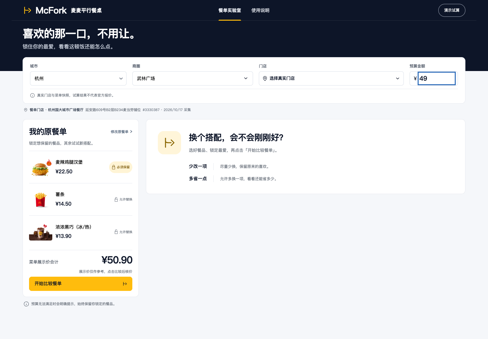
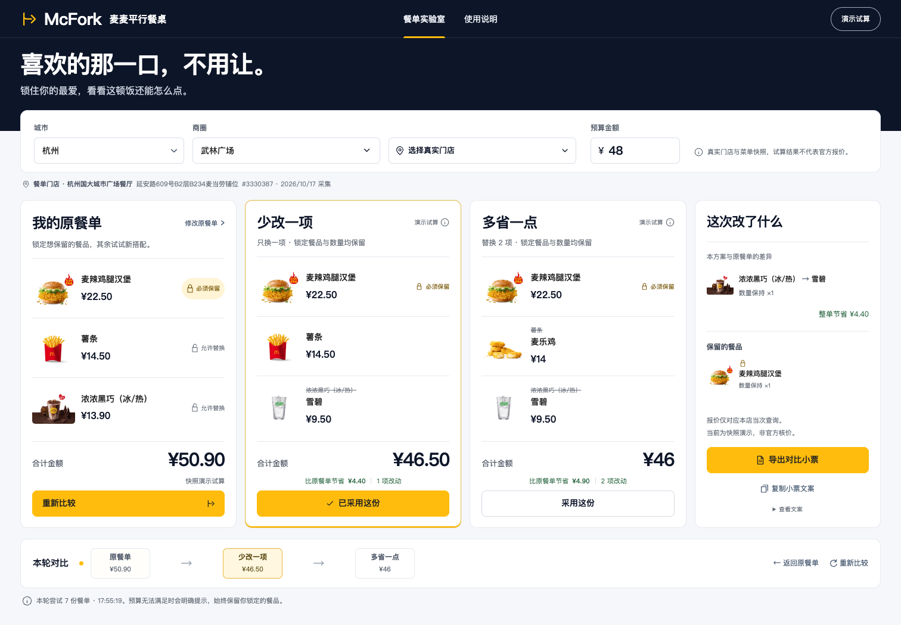
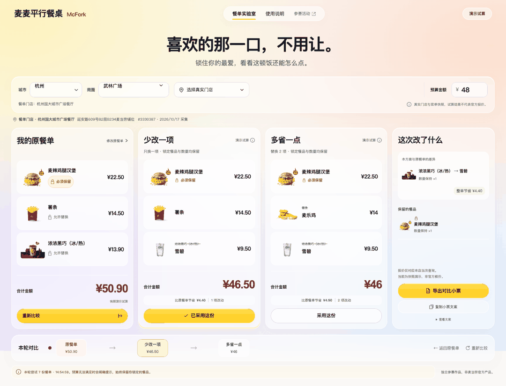

# 麦麦平行餐桌 McFork

**喜欢的那一口，不用让。**

先选一份想吃的餐单，再锁住不愿替换的餐品。McFork 用麦当劳中国 MCP 查询真实门店、当前菜单和整单价格，比较「少改一项」与「多省一点」两条路线，逐项说明变化，并导出对比小票。

适合想控制一餐预算、又有明确口味偏好的消费者，也适合在支持 Skill 的 AI 客户端里用自然语言比较餐单。**只需要麦当劳 MCP Token，不需要地图 Key 或额外 AI API Key。**

**[在线体验](https://everfu.github.io/mcfork/)**：网页部署于 GitHub Pages，通过独立后端查询真实门店、当前菜单与官方整单价格；也可以手动切换快照演示。Token 只保存在后端，访问者不需要填写密钥。







## 快速开始

需要 Node.js 24+。

```sh
git clone https://github.com/everfu/mcfork.git
cd mcfork
npm ci
npm run dev
```

打开 http://127.0.0.1:5175 。没有 Token 时使用真实门店与菜单快照演示；演示的整单金额为本地试算，不是官方当次核价。

实时模式：将 `.env.example` 复制为 `.env.local`，仅填写 `MCD_MCP_TOKEN` 后重新启动。Token 请从 [麦当劳 MCP 平台](https://open.mcd.cn/mcp) 自行申请；每人使用自己的账户，不共享作者凭据。页面只通过本机服务连接 MCP，Token 不发送到浏览器或放进前端构建。

```sh
npm run build
npm start
```

服务器固定监听 `127.0.0.1`。`PORT` 可修改本机端口；访问时使用 `127.0.0.1`，避免与其他项目的 localhost 预览混淆。

## GitHub Pages 部署

推送到 `main` 后，[发布工作流](.github/workflows/pages.yml)会安装依赖、运行决策测试并构建网页，只发布 `dist` 目录。仓库 Pages 来源设为 GitHub Actions；仓库变量 `MCFORK_API_URL` 提供公开后端地址，编译为 `VITE_API_BASE_URL`。这个地址不是密钥；任何 `VITE_` 变量都不能包含 Token。本机服务、环境变量文件和账户凭据不会部署到公开站点。

后端使用 [Netlify Functions](netlify/functions/api.mts)，配置见 [netlify.toml](netlify.toml)。在 Netlify 项目中将 `MCD_MCP_TOKEN` 保存为仅 Functions 范围的加密变量，`ALLOWED_WEB_ORIGIN` 设为 `https://everfu.github.io`。GitHub 环境中的 Secret 不会自动同步到 Netlify，也不会被前端读取。Netlify 项目链接状态 `.netlify/` 已加入忽略列表。

每次搜索返回一小时有效、绑定门店的签名选择凭证，供独立函数实例校验；它不能替代账户 Token，也不导出到小票。后端只允许指定网页来源和白名单接口，平台按 IP 限制每分钟 60 个请求。来源限制不是用户身份认证；此公开服务仍会消耗维护者的 MCP 与托管额度。

网页使用共享引擎生成候选，逐份请求 `/api/quote`，避免将整轮比较塞入一个有 60 秒限制的函数。单份核价超时、凭据失效及限流均明确报错，网络失败不会自动变成演示金额。CLI 和本机 `/api/compare` 继续使用相同引擎。未配置后端地址时，静态构建仍可单独体验快照演示。

后端当前为手动发布：修改接口代码后运行 `npx netlify-cli@27.13.0 deploy --prod --site mcfork-api`，CLI 会按配置检查类型并打包函数。GitHub Pages 前端持续自动发布，后端尚未连接 Git 持续部署。线上真实调用记录见 [后端联调证据](evidence/hosted-live-verification.json)。

## 体验流程

1. 从城市下拉框选择城市，加载对应商圈；选中商圈后自动查询真实门店。点击选店并核对官方返回的名称、地址与门店编号。
2. 修改原餐单，锁定必须保留的餐品。锁定项的 SKU 和数量均保留。
3. 设置整餐预算，点击「开始比较餐单」。
4. 选择经过核价的方案，看清具体替换与实际整单价差。
5. 下载 PNG 对比小票或复制文案，自行保存、分享。

门店信息通过 `query-nearby-stores` 查询，不使用第三方地图，不估计通勤耗时。实时核价示例及 traceId 见 [脱敏验证证据](evidence/mcp-live-verification.json)；它只证明记录中时间与门店的调用成功，不代表未来价格或全城覆盖。

界面使用 [HeroUI v3](https://heroui.com/en/docs/react/getting-started) 的 Select、Modal、Button、Input 和 Spinner，参考[麦当劳开放平台](https://open.mcd.cn/)的深蓝、金黄与白色设计，采用左侧编辑、右侧比较的布局，比较前收起空方案、差异与导出区域；选店和预算控件保持对齐。城市目录当前收录 37 个常用城市，商圈为项目维护的地点关键词（`shared/districts.ts`），并非官方完整商圈列表；未列出的地点可在商圈下拉框选择「其他地点」输入。切换城市会清空旧商圈和门店结果，过期查询不会覆盖新选择。演示仅提供杭州武林广场门店快照，其他地点需实时模式。

## 网页与 Skill

网页是结构化交互，不调用大模型。Skill 借用当前 AI 客户端理解自然语言，再调用相同的 CLI 和比较引擎，不额外申请模型 API Key。

Skill 文件：[skills/mcfork/SKILL.md](skills/mcfork/SKILL.md)。在支持 Skill 的客户端中加载此目录，并保留源码项目，用该项目根目录运行命令。当前未自动安装到任何客户端。

```sh
# 无凭据的确定性演示
npm run --silent fork -- compare examples/compare.json

# 使用本机 Token 搜索真实门店
npm run --silent fork -- stores examples/stores.json
```

实时菜单、详情与比较输入须带 `city`、`keyword` 和搜索返回的 `storeId`；餐品编号必须从本店当前菜单中取得。完整输入示例见 [Skill 参数说明](skills/mcfork/references/input.md)。

## 计算边界

- 同类替换仅覆盖可可靠识别的主食、小食、饮品；组合餐和不确定分类不自动替换，手动选择的默认搭配可在官方接口支持时核价。
- 保持原餐单种类数和每项数量，始终保留锁定项。不会删掉汉堡或把整餐变成空单以满足预算。
- 每个可替换项最多取三种更低展示价候选，最多尝试六份单项替换、五份双项替换及一份原餐单。展示价只用于初筛，最终排序和价差以整单核价为准；不承诺全菜单最优，也不探索展示价更高但可能触发优惠的组合。
- 「少改」优先改动项数少，再比较官方总价；「多省」只在有第二份更便宜的合格方案时出现。没有结果或部分接口失败时如实说明。
- 首版仅使用默认搭配，无自定义特调、优惠券组合、下单、支付或账户写操作。报价仅适用于本店当次查询。菜单和详情最多缓存五分钟，快照单独标注采集时间。
- 导出小票只含门店、餐品、金额、替换明细与查询时间，不导出 Token、账户信息和后台追踪信息。

## 验证与演示素材

```sh
npm test
npm run test:browser  # 默认使用已安装的 Google Chrome
npm run verify:live   # 使用自己的 Token，只读查询；更新脱敏调用证据
npm run inspect:mcp  # 查看四个实际工具的参数定义
```

浏览器测试默认连接已启动的 `http://127.0.0.1:5175`，用演示模式验证流程并单独模拟凭据失败，不耗用真实账户接口；可用 `MCFORK_BASE_URL` 改测试地址。测试结果输出到系统临时目录。

[一分钟演示视频](docs/media/demo.webm) · [首页演示动图](docs/media/demo.gif) · [演示脚本](docs/DEMO.md)

`npm run refresh:snapshot` 只从官方服务刷新公开门店/菜单快照，不保存账户信息。快照图片来源于官方菜单，首屏所需图片已保存在 public/food；其余图片加载无需额外 Key，不可用时显示餐品文字。

## 静态公开演示

构建产物 `dist/` 可部署至静态托管。公开网页只运行快照演示，不接入作者账户。Vite 使用相对资源路径，支持部署至仓库子路径。实时查询需要在本机运行服务；请勿将本机服务暴露为公共代理。

## 参赛材料与声明

项目含官方原样 `CONTEST_DECLARATION.md`、`MCP_INTEGRATION.md`、仅有环境变量占位符的 `mcp-config.example.json` 和可运行源代码。[报名内容与提交记录](docs/SUBMISSION.md)。

已提交官方活动仓库：[参赛申请 #823](https://github.com/M-China/mcd-developer-innovation-challenge/issues/823)。校验状态以官方 Issue 回复为准。

未使用 WorkBuddy 开发，因此不提供虚构的 `workbuddy.md`。作品为独立参赛项目，非麦当劳官方产品。原创代码采用 MIT 许可。官方声明、菜单数据及图片、第三方依赖遵循其各自的使用规则；图片仅用于餐品信息展示，不作品牌授权或官方背书声明。
